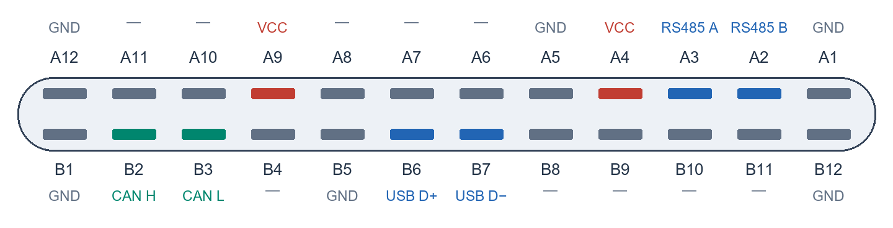

# T40 引脚与接线参考

[SVG 矢量版](images/t40-pinout.svg) · [PNG 高清版](images/t40-pinout.png) · [详细接线参考](images/t40-wiring.png)

## 接口方向

本图按 leommxj 的 **Type-C plug pinout** 图标号重绘，不是对本项目实物母座、转接板焊接面的测绘。原图上排从左到右 A12→A1，下排 B1→B12。焊接面可能镜像，转接板丝印也可能采用不同观察方向；应断电检查通断后确认针号。不能用普通 USB-C 正反可插的假设接线。

## 针脚表

| 雷达针脚 | 来源定义 | 本项目连接 |
| --- | --- | --- |
| A4、A9 | VCC | 外部雷达电源正极 |
| A1、A5、A12、B1、B5、B12 | GND | 电源负极、USB 信号地、CAN 信号地；按实际转接板共地设计核对 |
| B2 | CAN H | USB-CAN 的 CAN H；PEAK PCAN-USB DB9 为 7 脚 |
| B3 | CAN L | USB-CAN 的 CAN L；PEAK PCAN-USB DB9 为 2 脚 |
| B6 | AR1021x USB DP | 电脑 USB D+；USB-A 为 3 脚 |
| B7 | AR1021x USB DN | 电脑 USB D−；USB-A 为 2 脚 |
| A3、A2 | RS485 A、B | 本项目不接 |
| 其余针脚 | 来源未标注 | 不接，不推定为标准 USB-C 功能或空脚 |

PCAN-USB 的 DB9 3、6 脚为 CAN GND。其他品牌 USB-CAN 的 DB9 引脚可能不同，应看其手册，不按外形套用。PCAN 的可选 5V 输出不是雷达电源。

电脑经专用转接线连接雷达内置 AR1021x 的 USB 数据接口；这里的 D+/D− 不是串口 TX/RX。USB-A 4 脚为 GND，1 脚 +5V 在本参考接法中不连接，不与雷达 VCC 相连。若使用成品转接板，还需核对它自己的供电、保护与引脚定义。

CAN 使用 1 Mbps，总线两端通常各有 120Ω 终端；应先查已有终端，不能见线就加电阻。雷达内部是否已有终端需实测，本文不作假定。

## 供电

原作者文章引用培训资料指出 15V。本项目此前测试使用过 12V / 1A，后改为 12V / 3A。这是测试条件，不是设备额定输入范围。接线时按自己的设备铭牌和可信原厂规格确定电压、极性、电流能力。

## 参考资料

- [leommxj：DJI T40 RD2484R 雷达逆向分析](https://www.leommxj.com/2026/04/20/dji-t40-RD2484R-radar-reverse-engineering/)；[原始 Type-C 针脚图](https://pic.leommxj.com/blog/dji_t40_radar/dji_radar_Type-C_plug_pinout.png)。针脚排列与信号名称取自此图，本文重新绘制，未将未经确认的观察面称为实测接线方向。
- [PEAK：PCAN-USB User Manual](https://www.peak-system.com/produktcd/Pdf/English/PCAN-USB_UserMan_eng.pdf)，版本 3.2.0，§4.1（PDF 第 16 页）DB9 引脚及 §2.2 终端电阻。

重新生成插图：`python tools/draw_wiring.py`，需要 Pillow；Windows 默认使用微软雅黑，其他环境可通过 `WIRING_FONT` 指定中文字体文件。
